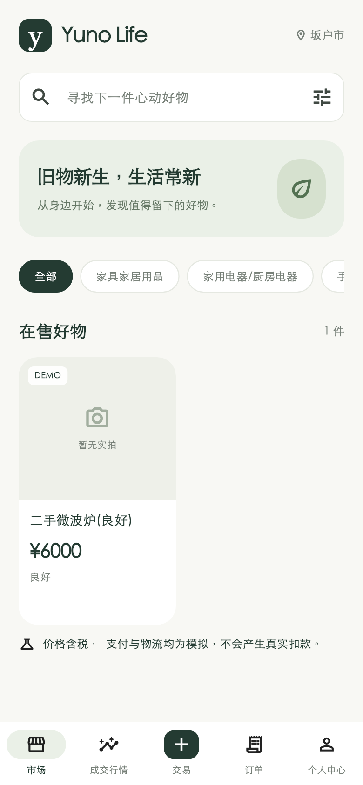
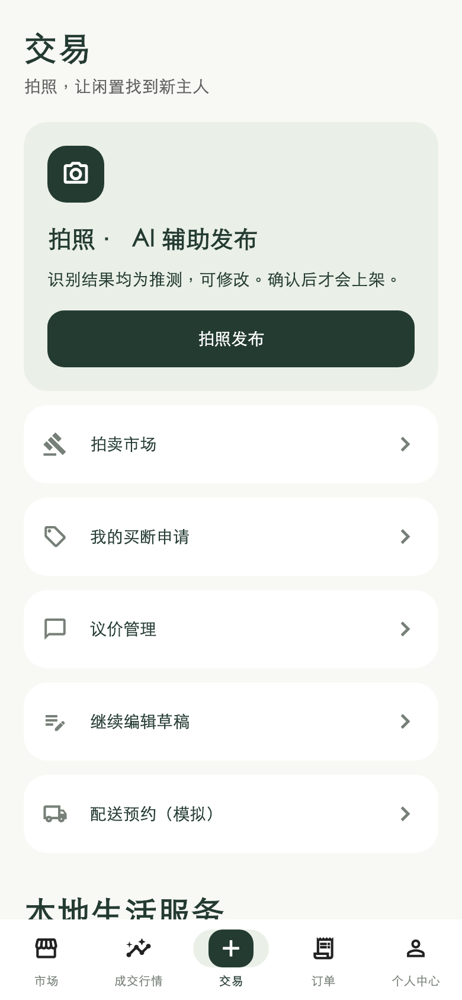

# 原生界面更新 · 0.2.0（3）

上一版 0.1.0（2）主要完成原生功能和 JSON 接口，本轮按用户对视觉完成度的反馈调整界面。

- 全局统一暖白、深绿与浅灰绿配色，缩小标题，调整字重、间距、输入框、按钮及卡片。
- 市场采用紧凑品牌区、搜索、可点击的分类筛选、双列商品卡片；缺少照片时明确标注。
- 底部保持五个入口，突出中间的交易入口；交易、订单空态、个人中心同步整理。
- 个人中心底部显示版本号，便于区分手机上的试用包。
- 保留模拟支付/物流、含税、DEMO 标注；未添加假商品、假照片或假行情。

静态检查无问题，5 项组件测试通过，包括 390px 屏幕上中日文长标题卡片布局。
Release 与 Profile 编译成功；设备已确认安装 0.2.0（3）。Mac 解锁后确认 Xcode 上次 Debug 构建因磁盘写满失败；仅清理本项目 DerivedData 的 Build 与 Index.noindex。随后设备接受启动请求，系统日志显示 Yuno 进程运行并联网，但截图仍被“无法验证 App”系统弹窗遮挡；等待关闭弹窗后复核。
尚未取得新版正常运行的真机截图，不能将本轮界面更新或全功能验收标记为完成。

以下是 Flutter 实际组件的**渲染预览，不是 iPhone 截图**。
内容来自本机公共 API 的当前数据：仅有一件无照片的 DEMO 商品。
预览使用本机字体；真机字体、系统字号与安全区域可能有所不同。

