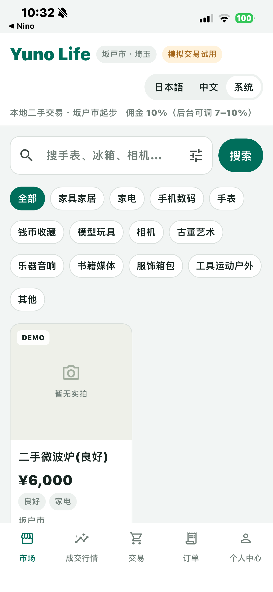
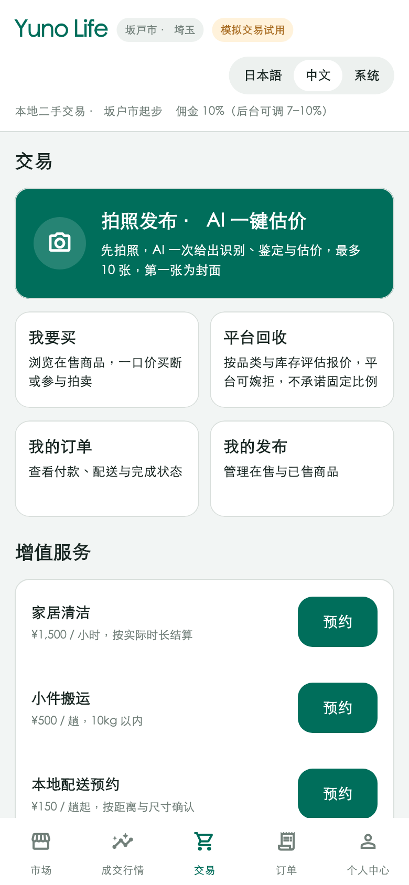

# 原生界面 · 0.3.0（4）

本页为历史记录，当前参考与真机截图见 [0.4.0 更新](NATIVE_UI_0_4.md)。

参考：[用户提供的 Muse 静态 UI/UX](https://muse.ai/s/yuno-life-codex-jing-tai-yan-shi-ban-vu6yw5xe2xlxox0/4ghjex3pvZY9jTEzJbfCuFDhxumN7Sn6s6QgmIz14vA)。
用户确认 GitHub main 基线为 `1ab6b8fe`；artifact 后续改动不在该提交内。
本轮依据可见界面重做 Flutter 原生布局，继续调用 `/api/v1`，无 WebView。

- 全局：青绿主色、浅灰背景、细边框白卡片、共享品牌/地区/语言栏、五个底部入口。
- 市场：搜索按钮、保留高级筛选、可换行分类、双列商品卡、成色与地区标签、千位分隔价格。
- 交易：绿色拍照主入口、我要买/平台回收/我的订单/我的发布四宫格、三项服务预约与配送说明；拍卖、议价、草稿和配送管理仍可用。
- 发布：大面积拍照与相册按钮，保留后置相机、多图管理、AI 分析与确认发布。
- 行情：涨/跌/不足三个统计、涨跌第一同屏突出、分类筛选和明细；依据仍以接口真实口径展示，未照搬演示的近30天均价口径。
- 订单：商品照片/标题、真实状态筛选、金额、模拟支付标识；没有配送记录时不把已支付写成配送中。
- 个人中心：用户卡、收藏与业务入口分组、规则折叠、员工权限控制；连接设置收在折叠区。

保留说明文件的中文/日本語/跟随系统三档；英文预留。未把演示商品、照片、价格或成交涨跌写进真实平台数据。
新增 API 仅补充个人收藏与订单商品展示字段，原交易逻辑不变。

验证：后端 104 项通过；Flutter 9 项通过；静态检查无问题；Release 构建成功，iPhone 安装版本为 0.3.0（4）。
以下是实际连接 iPhone 的市场截图，界面已进入市场并显示接口商品，不是浏览器或渲染预览。
当前数据仅有一件无照片的 DEMO 商品。设备字体及字号按手机系统设置显示。

下面是同一套 Flutter 交易组件的渲染预览，**不是真机截图**，用于对照布局。

完整交易流程及 Android 新版运行状态见 [验收记录](NATIVE_ACCEPTANCE.md)，本轮不将其标记为全部通过。
