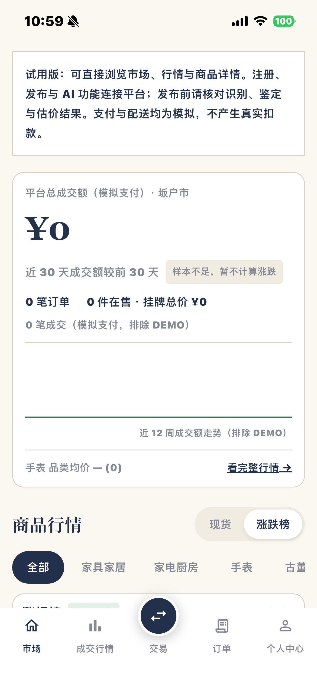
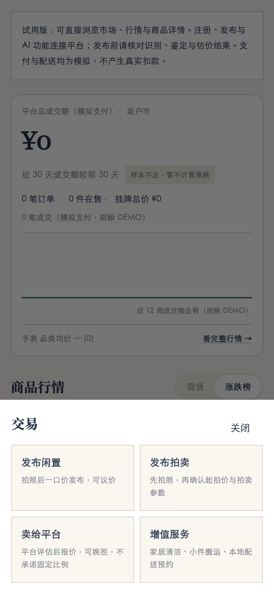
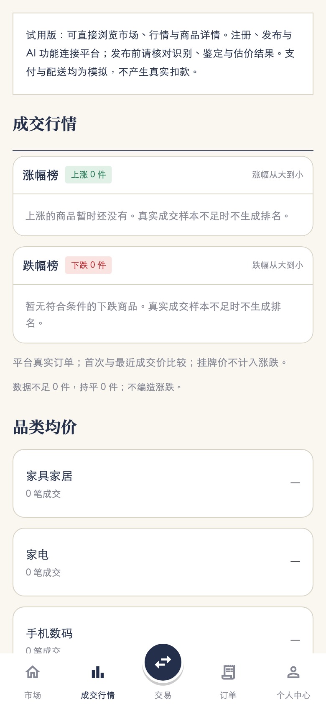

# 原生界面 · 0.4.0（5）

按用户 2026-11-05 提供的照片及随后重新加载的 [Muse 当前页面](https://muse.ai/s/yuno-life-codex-jing-tai-yan-shi-ban-vu6yw5xe2xlxox0/4ghjex3pvZY9jTEzJbfCuFDhxumN7Sn6s6QgmIz14vA) 对齐。
当前参考为米白底、藏蓝文字和衬线标题的概览首页；此前 0.3.0 的绿色品牌栏版本已被替代。

## 界面与交互

- 首页顶部为可滚动的试用说明，随后是成交总额、30 天对比、订单/在售计数、12 周成交额曲线、品类均价及完整行情入口。
- 商品行情提供现货/涨跌榜切换、分类、涨跌榜；涨跌仍按后端真实成交价格口径，逐行标注参考价，不把挂牌折扣当成成交跌幅。
- 首页下方包含配送尺寸价目、自营商品、拍卖专场、在售闲置；在售区提供分类、搜索、价格排序、收藏筛选及实际收藏操作，高级地区/价格筛选继续可用。
- 底部仅五个入口，中间为凸起的藏蓝圆形交易按钮，订单徽标来自当前账号记录。
- 交易按钮打开四项菜单：发布闲置、发布拍卖、卖给平台、增值服务。拍卖流程在商品确认后进入现有拍卖参数确认，不自动提交出价或收款。
- 行情页使用分栏标题和紧凑商品行；个人中心采用账号分区入口，语言控制移入个人中心。保留中文/日本語/跟随系统，切换立即生效。
- 金额、商品与照片来自现有接口；演示里的 ¥30,000、5 笔订单和商品价格未写入真实运行数据。支付与配送均明确为模拟。

中文标题使用随包提供的 Noto Serif SC（SIL Open Font License 1.1），避免 iPhone 缺少系统字体时回退成黑体。来源、校验值和许可见 `mobile/assets/fonts/README.md`。正文仍尊重手机系统的字号及加粗设置。

## 只读接口补充

`GET /api/v1/market` 新增 `overview`：非 DEMO 已模拟支付/完成订单的商品额、订单数、非 DEMO 在售总价、近/前 30 天统计及最近 12 个自然周的成交额。
30 天对比要求两期各至少两笔且基期金额大于零，否则返回 `null`；曲线无成交时为零，不制造走势。
`GET /api/v1/config` 增加现有 `delivery_rules`，配送价目直接读取服务端配置。
原交易业务、表结构、支付及权限规则保持不变。

## 验证

- 后端 106 项通过，新增统计测试验证 DEMO/未支付排除、时间分期、零样本及隐私字段隔离。
- Flutter 10 项通过，包括新概览/现货切换、完整行情跳转、四项交易菜单与服务跳转；静态检查无问题。
- iOS Release 构建成功（44.7 MB），安装清单确认为 0.4.0（5），设备接受启动并取得以下实际市场截图。
- 完整真机交易流程、相机硬件及 Android 新版运行仍未全部验收，不把界面更新记作全功能通过。

以下为 Flutter 组件渲染预览，**不是真机截图**。系统字体、加粗与字号设置可能影响真机间距。

