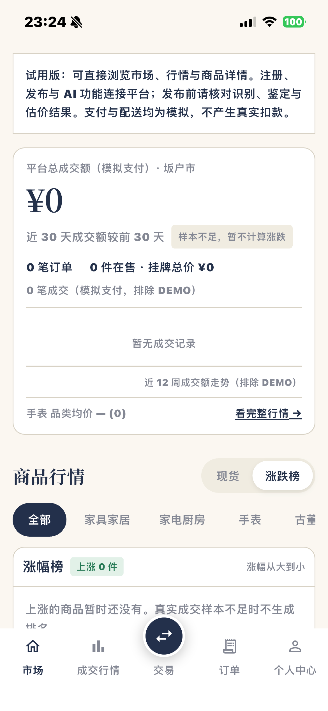

# 原生界面排版修正 · 0.4.1（6）

依据用户拍摄的手机照片，修正金额字形、纵向留白和全局控件风格。

- 原首页使用 Georgia，其旧式数字零在 iOS 上偏低、偏小，与日元符号不协调。金额改用随包提供的 Noto Serif SC，启用 lining/tabular 数字特性，统一符号与数字的字形；字号 34、行高 1.16，避免继承正文的松散行高。
- 压缩试用说明行距与底部留白、概览分隔线间距及图表高度。没有成交记录时显示明确空态和中性基线；有成交时继续展示真实曲线，不编造金额或走势。
- 涨跌榜表头固定左对齐，标题和数量徽标在小屏/大字体下可换行，排序说明靠右。
- 全局表单、按钮统一 8 像素圆角；交易面板顶部 20、菜单卡片 12 像素圆角，和现有概览卡片相协调。
- 页面标题、段落标题统一衬线层级；导航标签由 10 调至 11；个人中心登录按钮统一藏蓝，账号卡片使用全局圆角。五个底部入口及所有交易行为保持不变。
- 保留系统字体缩放与加粗设置，没有为了截图关闭无障碍设置。

## 验证与安装

13 项 Flutter 检查通过，包括 320 宽/1.5 倍文字的中日文页面、五个入口、零金额和大金额、语言切换及原有表单/照片限制；静态检查无问题。
真实字体的组件渲染用于本机检查，未将其当成真机证据。

正常 Release 构建 44.7 MB，签名深度校验通过；连接 iPhone 安装清单确认版本 **0.4.1，build 6**，已成功启动。
日志位于本机忽略目录 `outputs/ui-polish-final-tests.log`、`ui-polish-analyze.log`、`ui-polish-ios-build.log`、`ui-polish-install.log`、`ui-polish-launch.log`。

以下是本轮安装后取得的 **实际 iPhone 截图**：

本次只更新原生界面与测试，后端业务与数据未修改。之前 0.4.0 的主要交易流程通过证据保留；本次没有重跑全部交易或补齐 Android、真实相机等未验收项目。完整验收状态见 [验收记录](NATIVE_ACCEPTANCE.md)。
